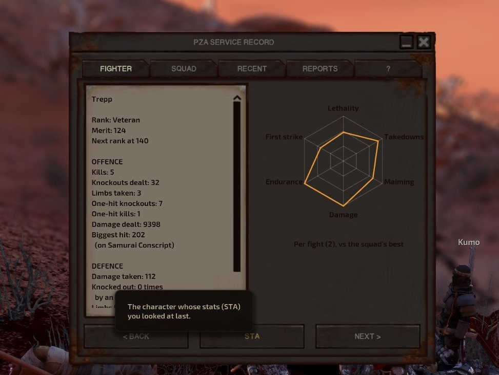
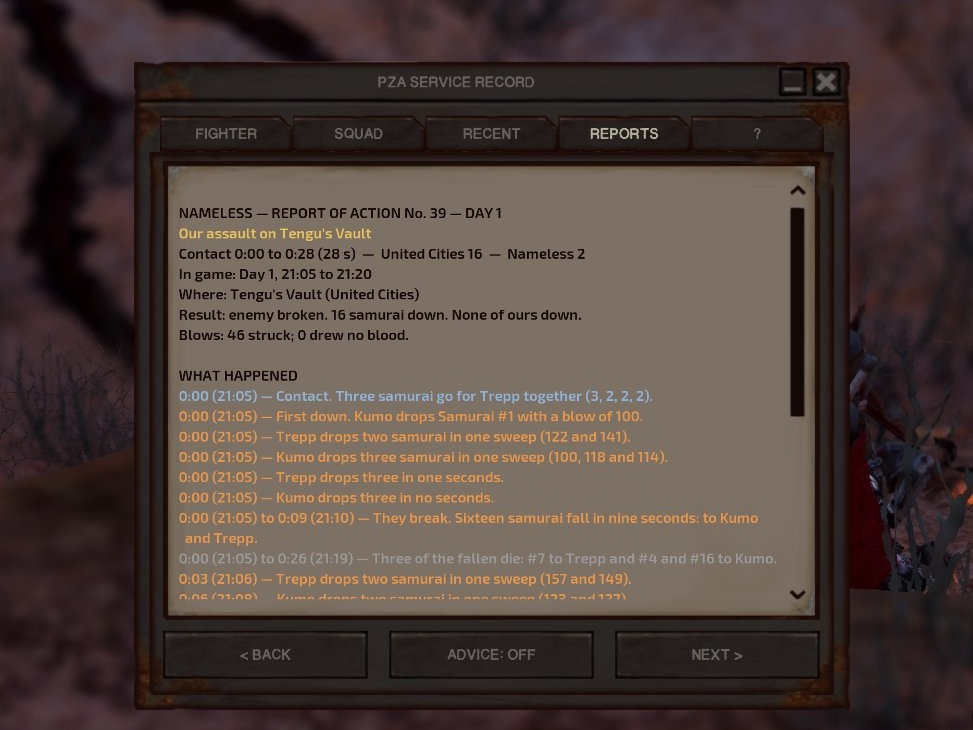
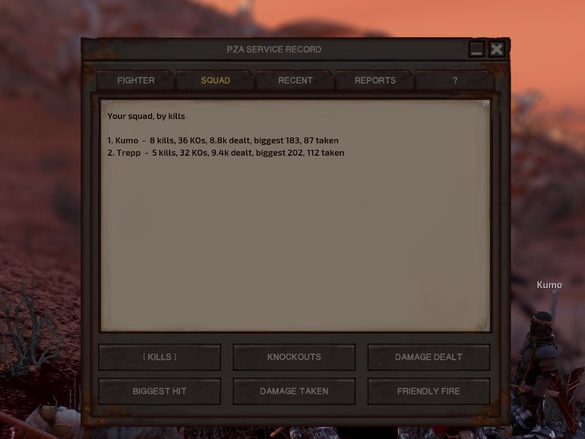
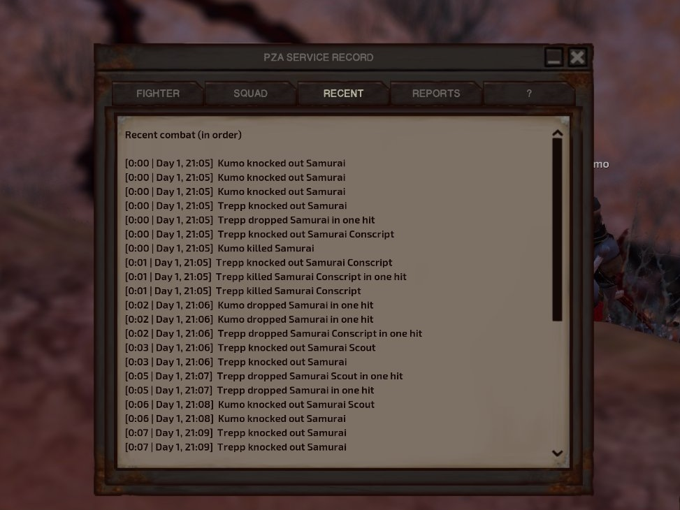

# PZA's Service Record for Meitou

> **Version 0.1.8** (beta) · loads on Meitou 0.20.1 and newer (no upper cap) · checked on 0.20.1, 0.21.0, 0.22.1 and 0.22.2 nightlies · windows on
> [PZA's Meitou UI](https://github.com/Meitou-Modding-Ecosystem/PZAMeitouUi) · English, Russian, Chinese, Japanese (the battle reports are
> English for now) · GPLv3 or later · by PZA

A combat record for every fighter in your squad. Service Record counts what each of your people actually does in a fight (who they drop,
how hard they hit, what they take, who carried the battle) and keeps it with the character in the save. It is a port of the RE_Kenshi plugin
PZA Service Record 0.13.0 to Meitou, aiming at full parity: the same rules, numbers, lines and save keys.

## What it does

- **Per-fighter stats.** Kills, knockouts dealt and suffered, limbs taken and lost, damage dealt and taken, the biggest hit (and on whom),
  one-hit knockouts and one-hit kills, damage dealt by body part (Head, Chest, Stomach, Arms, Legs), combat damage and kills by target type
  (Humans, Skeletons, Animals), turret stats tracked separately so gunners do not inflate personal combat totals or rank, slavery history
  (`Slave of <Faction>, Day X to Y`), friendly fire on its own line, and fights counted. Clear rules decide the credit: a kill goes to the last
  hit before death, a death more than 10 game minutes after the last hit is "died of wounds", a knockout goes to the blow that dropped the
  victim, and someone already lying down when first seen is not a new knockout. Stealth knockouts count too.
- **Ranks.** Every fighter earns a rank from their own record (Recruit to Legend). A rank changes nothing in the game.
- **The chart.** Six axes on the Fighter page (Lethality, Takedowns, Maiming, Damage, Endurance, First strike), each scored against the best
  in your squad, per fight. Hover a label for the number and who holds the squad's best.
- **After-Action Reports.** When a fight ends (30 seconds without a blow), a report is written: who opened it, who held the line, who carried
  it, the leader's fall, friendly fire, what happened after. Every report is also kept in a text file per faction, so your history survives
  the session.
- **Recent.** This session's knockouts, kills, limbs and friendly fire involving your people, with session time and Kenshi's own clock.
- **STA lines.** Up to three compact lines (or all twelve) in each character's own stats window.
- **The window.** Shift+R opens Fighter, Squad, Recent, Reports and a Help page. Shrink it to a small button you can drag; F7 hides it with
  the game's interface. Places, page, sort and settings survive a restart; rules and report settings apply at once from Settings > Mods.
- **One record, both games.** The record is saved in the character's own save data under the RE_Kenshi plugin's keys. A save played with the
  original-game plugin carries its history into Meitou and back, including Military Manager posts (shown and kept). Kill Counter's numbers are
  imported once if they are there.

## What's new in 0.1.8

- **Turrets tracked separately:** turret damage dealt, kills, knockouts and limbs taken have their own **TURRETS** section on the Fighter page and no longer inflate combat totals, Merit, Rank or the six-axis chart (turret friendly fire still goes to Friendly Fire).
- **Damage dealt by body part:** combat damage dealt is broken down across **Head**, **Chest**, **Stomach**, **Arms** and **Legs**.
- **Breakdown by target type:** combat damage dealt and combat kills are split across **Humans**, **Skeletons** and **Animals**.
- **Slavery history:** records each character's enslavement stints (`Slave of <Faction>, Day X to Y` / `since Day X`), saved with the character.
- **0.1.7:** encounters with mixed United Cities patrols name their soldiers `samurai` instead of stripping `-s` from `cities`; irregular faction plurals (`Shinobi Thieves` -> `thief`/`thieves`, `City Heroes` -> `hero`/`heroes`) and non-person trailing faction nouns are handled cleanly too.
- **0.1.6:** friendly fire uses Meitou's `DialogueSystem.RegardsFriendly` looked up by name, so it works on Meitou 0.22.2 nightlies as well as 0.20.1–0.22.1.
- **0.1.5:** a new game or load starts clean — records, clock, Recent lines and any open fight no longer carry over from a previous world.
- **0.1.4:** window position, tab, sort and Advice survive restarts; settings apply immediately; Military Manager posts saved by RE_Kenshi are shown and preserved; radar labels stay clear of the Fighter list; report times and Day match Meitou's HUD.

## What's planned

- **Military Manager** (0.2.0): the original-game plugin's chain of command, posts and portrait marks, ported to Meitou.
- **Deaths from Meitou's own death notice** instead of the short poll the port uses today.
- **A small read-only `ServiceRecordApi`** for other mods (below), and **TWR's titles on the Fighter page**.

## How it fits the ecosystem

Service Record keeps to one lane: what each fighter does in combat, measured. Other mods in the
[Meitou-Modding-Ecosystem](https://github.com/Meitou-Modding-Ecosystem) tell the rest of the story, and the pieces fit side by side:

| Mod | Its lane |
|---|---|
| [The Wasteland Remembers](https://github.com/Meitou-Modding-Ecosystem/TheWastelandRemembers) | How the world remembers your squad: town heat, bounty hunters, rivals, town talk, and its own squad record of deeds and titles |
| [Rivalry Core](https://github.com/Meitou-Modding-Ecosystem/RivalryCore) | How factions size up the player and act on it: hunts, raids, reinforcements |
| [Dustlife](https://github.com/Meitou-Modding-Ecosystem/Dustlife) | The war between factions off screen: sieges, raids, marching bands |
| **Service Record** | How each of your fighters fights: the combat numbers, the ranks, the battle reports |

They don't need each other. Each runs alone, and each gets better when the others are there.

## A proposal: working together

Proposed in [RivalryCore#140](https://github.com/Meitou-Modding-Ecosystem/RivalryCore/issues/140), for discussion with the other authors.
Service Record would offer a small read-only API in the style of TWR's `WastelandApi`: found by reflection, plain types only, nothing
throws, null when the mod isn't installed.

- `Stats(character)`: kills, knockouts dealt and suffered, limbs, damage dealt and taken, biggest hit, one-hit knockouts, fights.
- `Rank(character)`.
- `Battles(since)`: each battle report, with when, where, who fought and the outcome.

What that could make possible, if the other authors want it:

- **TWR's titles on the Fighter page.** Service Record reads TWR's `SquadTitles()` and shows each fighter's titles next to their numbers.
  Deeds and titles stay TWR's.
- **Rivalry Core** could ask which of the player's fighters is the most dangerous before deciding who to hunt.
- **Dustlife** could name a squad's veteran in its war news.
- **A kill cam** (PZA's Director's Kit with PZA's SlowMo) could fire on a credited kill rather than on any blow.

Every one of these is an optional read. No mod would depend on another, and each would carry on unchanged when the other isn't installed.

## Install

Releases: [GitHub releases](https://github.com/Meitou-Modding-Ecosystem/PZAMeitouServiceRecord/releases). Unpack into Kenshi's folder
(`Kenshi\mods\PZAServiceRecord\`) and tick **PZAServiceRecord** in Meitou's mod list. If you also use PZA's Service Record for RE_Kenshi, it
is the same folder on purpose: each game loads only its own file.

Building from source: [BUILD.md](BUILD.md).

## Licence

GNU GPL version 3 or later (`LICENSE`). Made by **PZA**. Unofficial fan-made mod; not affiliated with Lo-Fi Games.
